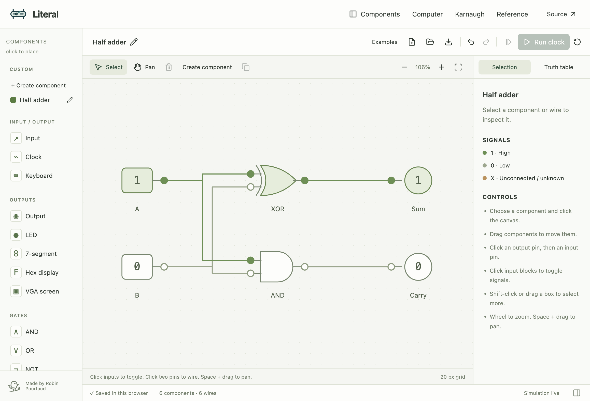
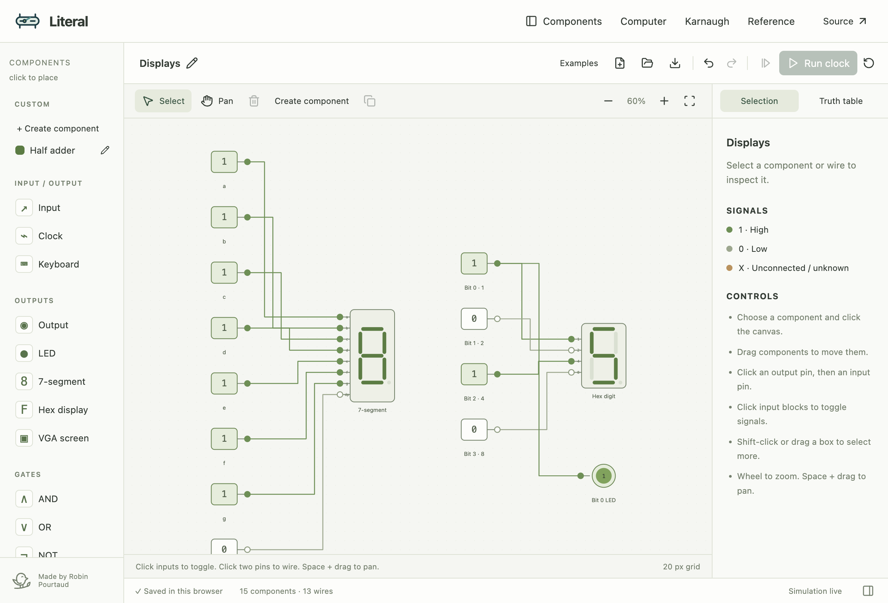
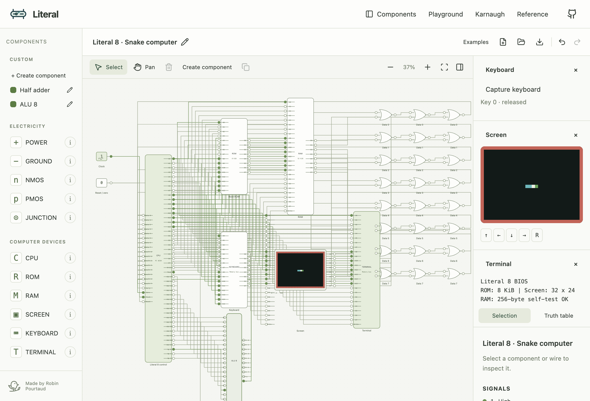
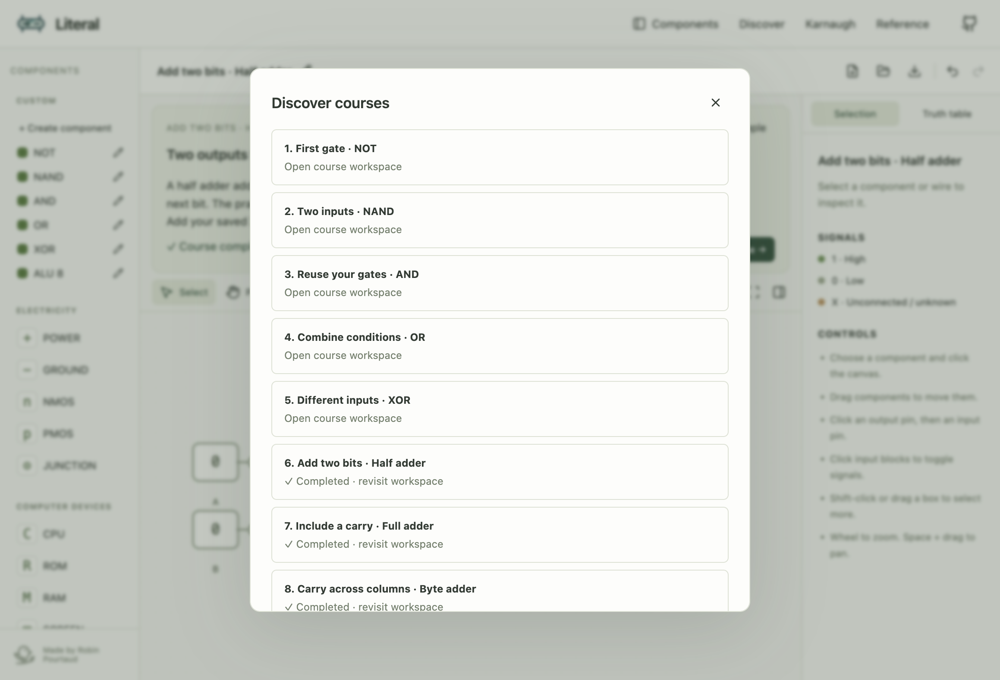
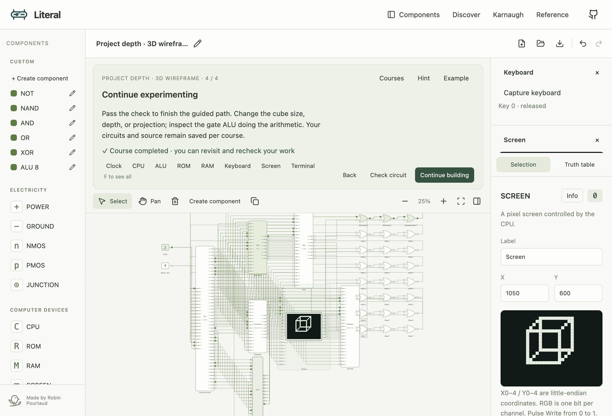
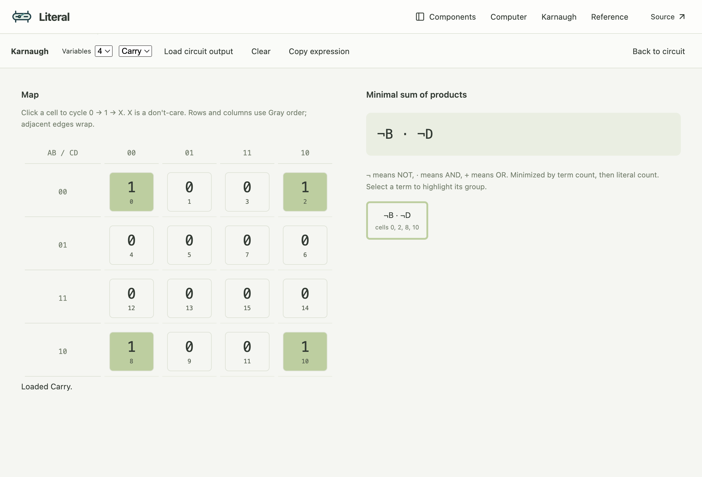
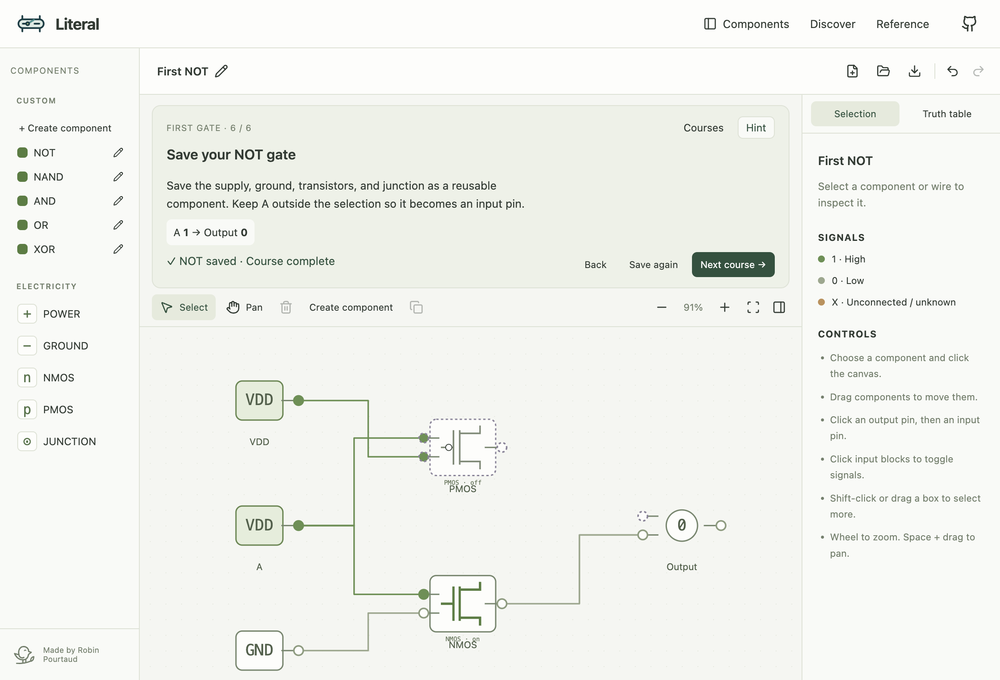

# Literal

A digital logic circuit editor and simulator for the browser, inspired by
Logisim. Draw gates, connect their pins, and inspect signals as the circuit
runs. All circuit execution and storage happen locally in the browser.



## Features

- Full-height SVG canvas with grid snapping, selection boxes, group movement,
  zoom, and pan.
- LEDs, seven-segment and hexadecimal displays, and a VGA-style pixel screen.
- Mapped physical / virtual keyboard, byte registers and counters, an eight-bit
  adder, 256-byte RAM, and editable ROM.
- Wired eight-bit computer example with a gate ALU, BIOS boot routine, opcode
  game, memory inspection, and ROM editing.
- Karnaugh maps with circuit-output import and exact sum-of-products
  minimization.
- Reusable custom components with named pins, colors, shapes, and nested
  circuits.
- Input switches, output indicators, clocks, AND, OR, NOT, NAND, NOR, XOR, XNOR,
  buffers, multiplexers, and D flip-flops.
- Live `0`, `1`, and unknown `X` signals, with feedback diagnostics.
- Clock stepping, automatic clocks, and simulation reset.
- Component labels and positions, undo/redo, copy/paste, duplication, and
  deletion.
- Truth tables with clickable input combinations and CSV export.
- Browser autosave and validated `.literal` JSON import/export.
- Half adder, full adder, multiplexer, register, and toggle flip-flop examples.
- Keyboard controls and reduced-motion support. The compact sage interface
  follows ISETL Web.

Literal uses single-bit wires. Custom components currently support combinational
logic. Buses, sequential custom components, asynchronous latch simulation, and
Logisim `.circ` import are not implemented.

## Run locally

Install Deno 2, then:

```sh
deno task dev
```

Open the local URL printed by Vite. No application server or account is
required.

```sh
deno task test
deno task build
deno task preview
```

The production build is a static site in `dist/`. Vite runs through Deno's npm
compatibility layer; Node and npm commands are not required.

## Drawing and simulation

Choose a component, then click the canvas. Press Esc to return to selection.
Click an output pin and an input pin to connect them. Each input accepts one
driver; outputs can drive multiple inputs. Crossing wires do not create a
junction.

Click an input block to toggle it. Drag components to move them. Shift-click or
drag a selection box to select several. Wheel to zoom, Space + drag to pan, and
F to fit the circuit. The Reference button lists all keyboard controls. Keyboard
placement is available through Place at center.

Clocks alternate at 2 Hz when running. Step changes the clock level once. D
flip-flops capture on a known rising edge, start at zero, and hold their value
between edges. Opening a file, reloading, undoing, and resetting clear flip-flop
memory. The circuit document stores input and clock levels, not simulation
memory.

Autosave keeps the current circuit in this browser's local storage. Download a
`.literal` file to keep a portable copy. Opening a file replaces the current
circuit; Undo restores it during the session.

## Custom components

Select components and choose **Create component** in the library. Give the
component a name, color, and shape. Input and Output blocks define named pins;
connections crossing the selection and unconnected gate inputs are converted to
pins automatically. The saved component appears under **CUSTOM**, ready to place
in this circuit or a new one.

Use the pencil beside a library entry to rename it or change its color and
shape.

Definitions are snapshots of the selected logic. Custom components can contain
other custom components and have multiple outputs. Their pins are ordered by the
Input and Output blocks in the definition. Stateful and interactive devices must
remain outside custom components.

The library is saved in this browser. Circuit downloads embed the definitions
they carry; opening a circuit adds its definitions to the library. Keep a
downloaded circuit containing your components as a portable backup.

## Displays

**7-segment** accepts eight separate signals: a at the top, then b/c on the
right, d at the bottom, e/f on the left, g in the middle, and dp for the decimal
point. High lights a segment, low turns it off, and unknown is shown in amber.

**Hex display** decodes four inputs with weights 1, 2, 4, 8 from top to bottom,
displaying 0–F. Connect all four pins; unknown inputs produce amber segments.
**LED** provides a single signal lamp. The Displays example contains all three
outputs. Truth tables include one column per display input.



## Computer and Karnaugh tools

Load **Examples → Snake computer** to place the CPU, ALU, ROM, RAM, keyboard,
screen, and terminal on the circuit canvas, connected by individual bit wires.
The screen renders its framebuffer directly on the component. Select a device
for its controls in the right panel, or pin it there for continuous inspection.
ROM accepts assembly or hex bytes; RAM accepts hex writes. Keyboard controls
include virtual keys, physical capture, and remapping.

Select a **Clock** component to access **Run clock**, **Step**, and **Frequency
(Hz)** in the right panel. Each clock runs independently and keeps its frequency
in the circuit file. Adjust its frequency while running. The measured rate shows
when the circuit cannot reach the requested frequency. At slow rates, hold keys
long enough for the program to poll them. **Step** toggles the clock once.

The BIOS tests RAM and starts Snake, written in Literal 8 assembly. Arrow
presses move one cell; collect food, avoid walls and your body, and press R to
restart. See [the machine and instruction reference](docs/computer.md).



**See inside** opens reusable components recursively. Logic gates expose CMOS
switch networks, and transistors expose their terminals and structure. The ALU
is the actual simulated gate circuit: changing its wires changes CPU results.
Instruction control, registers, and memory remain behavioral models. Transistors
use digital switch semantics, including high impedance and conflicting drivers;
this is not an analog electrical simulator or a PC BIOS emulator.

Choose **Discover** to start with power, ground, transistors, and junctions. The
tutorial stays above the canvas; **Hint** opens a short explanation. Each course
keeps its own canvas. **Next course** advances after a functional check;
**Courses** revisits unlocked workspaces. Placing one component returns to
Select. **Playground** provides all devices and examples immediately, in a
separate workspace.

Discover now has **23 courses**, from a first transistor gate to a connected
computer running a game and a small 3D wireframe:

- NOT, NAND, AND, OR, XOR
- Half adder, full adder, eight-bit ripple-carry adder, multiplexer
- SR latch, byte register, RAM, ROM
- One-bit ALU, wired CPU, opcodes, BIOS
- Pixels, filled triangle, keyboard input, animation, move-to-target game,
  orthographic 3D projection

The first gates must be tested and saved as reusable components. Later labs
provide labelled input/output probes or an editable practice machine. **Check
circuit** tests a fresh copy without changing the live canvas. It reports the
failing input, memory value, or pixel. **Example** shows reference wiring or
assembly and target images. A passed lab persists completion; revisiting or
editing it preserves the achievement and lets you recheck the current circuit.
Relevant devices become available as their courses introduce them. **Karnaugh**
is available from XOR onward to explore Boolean expressions.

The latch lab exposes both CMOS networks because feedback across separate custom
gates is not supported. Clocked flip-flops, RAM, ROM, the CPU controller, and
peripherals are behavioral devices. The computer's ALU is a gate network; **See
inside** inspects it recursively. The projection lesson uses CPU arithmetic and
pixel writes; it does not implement a GPU or a complete transistor CPU.





See [the course guide](docs/discover.md) for checks, persistence, and model
scope.

Open **Karnaugh** to edit a 1–4 variable map or load an output from the current
combinational circuit. Cells cycle through 0, 1, and don't-care X. Gray
ordering, wrapping groups, and a minimal sum-of-products expression update as
you edit.



The **Keyboard pixels** example demonstrates physical-key mapping and pixel
writes. The **Byte counter** example connects a clocked eight-bit counter to
hexadecimal displays.

## Browser API

A short comment at the start of the HTML points agents to `/api.md`. The page
exposes `window.literal` for reading/editing circuits, input and clock control,
custom components, CPU execution, and Karnaugh simplification. Calls update the
same UI and autosave as manual interactions. No WebMCP or special browser
support is required.

```js
window.literal.getTools();
await window.literal.loadExample("half-adder");
const state = await window.literal.getState();
```

See [the browser API reference](apps/web/public/api.md). Use
`deno task api-check` with the Orca preview to check the API against the live
app.

## Reusable simulation core

`packages/core` has no DOM dependencies. It can be imported by a Deno program or
bundled into another frontend:

```ts
import {
  parseCircuit,
  simulate,
  truthTable,
} from "./packages/core/src/index.ts";

const circuit = parseCircuit(await Deno.readTextFile("adder.literal"));
const result = simulate(circuit);
console.log(result.values, result.warnings);
console.log(truthTable(circuit).rows);
```

Pass `result.memory` to the next `simulate` call to preserve flip-flop state.
Use `parseCircuit` to validate external documents. See
[the circuit format](docs/circuit-format.md).

Select a component and click **Info** in the right panel. Its popup explains
what it is, why it is useful, how to connect it, and a small example. Custom
components can store an editable description with their circuit definition.



Placing a component returns to **Select** mode. Choose a component again when
you want another copy.

## Development

- `packages/core/`: gate evaluation, state, document validation, and truth
  tables.
- `apps/web/`: editor, SVG renderer, examples, and styles.
- `tests/`: Deno simulation and validation tests.
- `scripts/browser_check.ts`: interaction checks using Orca's embedded browser.

To repeat the browser checks, start `deno task dev --port 5176`, open an Orca
browser tab for this worktree, and run `deno task browser-check`. Run
`deno task features-check` to check displays and custom-component creation and
reuse. Run `deno task computer-check` for screen writes, BIOS execution, device
controls, adjustable clock frequency, recursive transistor inspection, and
discovery mode. Run `deno task discover-check
deno task curriculum-check` to
check the first-gate lesson, descriptions, saving, and persistence. Run
`deno task clock-check` to verify independent playback, saved frequencies, and
the compact layout. Computer, Discover, and API checks preserve the browser's
saved circuits, library, mode, and preferences. The checks dispatch DOM pointer
and keyboard events through Orca's browser evaluation API; they do not certify
native mouse or touch input.

See [CONTRIBUTING.md](CONTRIBUTING.md). Original code is MIT licensed. Logisim
is an inspiration; no Logisim source is included.
